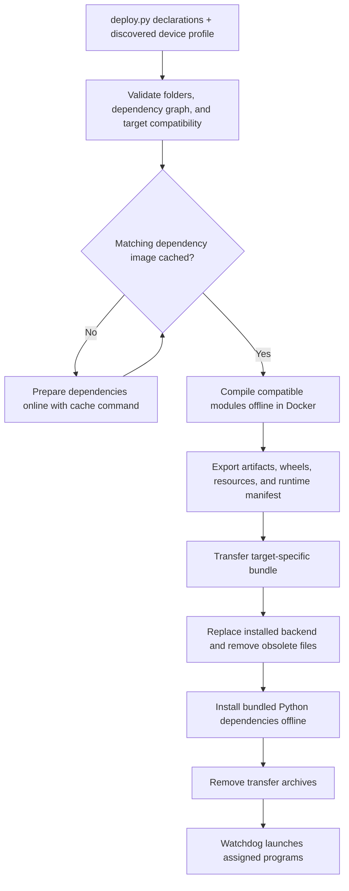

# Backend structure and deployment architecture

This guide describes the current module layout, build pipeline, target runtime,
frontend integration, and native library loading. For complete deployment file
examples, see [deployment examples](deployment-examples.md).

For moving an existing application's source and declarations into this layout,
see [backend migration](backend-migration.md).

## Development layout

```text
project/
├── backend/
│   ├── deploy.py                 Module declarations and process placement
│   ├── deployment/               BLITZ deployment tooling
│   ├── generated/                Shared portable generated stubs and files
│   │   └── messages/
│   │       └── portable.py
│   ├── python/
│   │   ├── common/               Shared Python source
│   │   └── control/
│   │       ├── main.py
│   │       ├── helpers.py
│   │       └── assets/
│   ├── cpp/
│   │   ├── common/               Shared native source and headers
│   │   └── vision/
│   │       ├── CMakeLists.txt
│   │       ├── library.cpp
│   │       └── include/
│   └── rust/
│       ├── common/               Shared Rust source or crate
│       └── telemetry/
│           ├── Cargo.toml
│           └── src/
├── requirements.txt              One shared Python dependency manifest
└── build/backend-bundle/         Generated contexts, bundles, inventory, and logs
```

These names illustrate a project; they are not modules automatically registered
by BLITZ.

### One module owns one folder

- Module folders live directly under `backend/<language>/<module-folder>`.
- A folder and everything belonging to that subproject form one module. Helper
  files, assets, headers, and build configuration are not separate modules.
- Two module declarations cannot share a source folder, including through
  symlinks. Module IDs and process IDs are distinct and must be unique.
- A declared entrypoint selects the program watchdog starts. It does not split
  its source folder into multiple modules.
- Python sibling modules are not automatically exposed as import paths. Shared
  source belongs in `backend/python/common/` and is copied into each Python
  module's bundle as `common/`.
- `backend/generated/` is a shared, language-neutral folder, not a runnable
  module. It is bundled automatically in `shared/backend/generated/`. Python
  programs import it as `from backend.generated import ...`; nested packages
  retain their structure. All languages can locate its files through
  `BLITZ_GENERATED_DIR`. Generated files must exist before preparation; this
  does not run a code generator or install extra dependencies. Source changes
  rebuild the bundle without invalidating the dependency image.
- C++ and Rust builds can reference their language's `common/` folder explicitly;
  native staging preserves the backend tree for relative build references.
- Backend source symlinks cannot escape the configured backend root. The layout
  is an application convention, not a sandbox for arbitrary program or build code.

All Python programs share the root `requirements.txt` and one device virtual
environment. They cannot request different installed Python dependency versions.
Native source is compiled into outputs; Python source is copied. Native headers
and resources are exported through `ModuleOutputs`, so folder ownership does not
mean all native source files are copied to the target.

## Simple declarations and automatic source locations

Inside `backend/deploy.py`, initialize the catalog once:

```python
from backend.deployment.module.catalog import BackendModules

modules = BackendModules(__file__)


def get_modules():
    return [
        modules.cpp_library("vision"),
        modules.python(
            "control",
            process=ProcessType.CONTROL,
            entrypoint="main.py",
            dependencies=("vision",),
        ),
    ]
```

`ProcessType.CONTROL` is supplied by your `WeightedProcess` enum; see the complete
template in [deployment examples](deployment-examples.md).

The catalog resolves the directory containing `deploy.py`, then derives
`cpp/vision` and `python/control` beneath it. There is no manually constructed
`ROOT / "backend/..."` path. Installer projects may rename the backend folder;
the catalog resolves the actual location, including an import alias symlink.

The deployment options use `.set_local_backend_path(modules.backend_path)` to
select that detected root. Source resolution does not depend on the shell's
working directory. Run deployment commands from the project root because the
existing requirements and build-output paths are project-relative.

The supported convenience methods are `python`, `cpp`, `cpp_library`, `rust`,
and `rust_library`. Python defaults to `__main__.py`; use `entrypoint="main.py"`
or a typed `PythonEntrypoint` to choose another file or runnable package. Native
`executable` defaults to the module name. C++ defaults to CMake. Older typed
constructors remain supported.

Keep both public hooks:

- `get_modules()` declares the complete module/dependency graph.
- `pi_name_to_process_types()` assigns runnable process types to devices.

The builder compiles all compatible declared modules for each target profile,
regardless of which processes are assigned to that particular device. Target
requirements can restrict architecture, distribution, Python version, and
capabilities such as CUDA. Incompatible modules and their consumers are skipped;
assigning an incompatible process fails before compilation or transfer.

## Frontend relationship

| Frontend | Layout and relationship to BLITZ |
| --- | --- |
| Repository website | `website/` is a standalone Next.js marketing/documentation app. Routes live under `website/src/app/`, components under `website/src/components/`. It is deployed separately from backend bundles. |
| WPILib robot application | Your external Java WPILib project owns its robot application. Its `deployBackend` Gradle task invokes the Python deployment tooling. |

Neither frontend automatically imports backend modules or loads their native
libraries. Runtime communication requires an explicit API, messaging connection,
or other IPC implemented by your application. Native library dependencies do not
automatically connect independently running processes.

## Build and deployment flow



From the project root, the default command is:

```bash
.venv/bin/python backend/deploy.py
```

It discovers devices through mDNS, records profiles, generates one Dockerfile per
distinct target profile, checks dependency caches, builds offline, and distributes
bundles. Use repeatable `--device HOST:PORT` arguments to query watchdogs directly
without mDNS.

If dependencies are not cached, discovery records the target profiles and
deployment stops with instructions. Connect the build computer to the internet:

```bash
.venv/bin/python backend/deploy.py cache
```

Reconnect to the device network and rerun deployment. New target profiles or
changed dependencies require matching cache preparation. Source and resource
edits reuse dependency images. An older cached dependency image may be offered
through an explicit override; it may lack newly requested dependencies and does
not bypass target compatibility checks.

Docker is the build environment on the development computer. The device receives
compiled files and dependencies, not a Docker runtime image. The generated
Dockerfile invokes predefined build/provision scripts rather than containing
each module's installation commands directly.

### Development outputs

```text
build/backend-bundle/
├── contexts/<system-id>/         Dockerfile, scripts, plans, staged sources
├── systems.json                 Recorded device identities and profiles
├── artifacts/<system-id>/        Extracted build outputs
├── logs/<system-id>/             Dependency, compilation, and extraction logs
└── outputs/
    ├── <system-id>.zip           Target-specific bundle
    └── bundle-index.json         Bundle checksums
```

These are local generated artifacts, not source modules. Docker's dependency
images remain cached locally for future deployments.

## Installed layout and single-bundle retention

For an example installation root of `/opt/blitz`:

```text
/opt/blitz/
├── .venv/                        Shared target Python environment
├── watchdog/
└── backend/                      One active installed bundle
    ├── deployment/               BLITZ API matching the bundle's deploy.py
    ├── deploy.py
    ├── build-plan.json
    ├── runtime-manifest.json
    ├── python/control/
    │   ├── main.py
    │   ├── helpers.py
    │   └── common/
    ├── cpp/vision/               Compiled module outputs
    ├── lib/vision/
    │   └── libvision.so          Namespaced library exports
    ├── include/vision/           Declared header exports
    ├── resources/control/        Declared resource exports
    └── deps/
        ├── python/               Offline wheels and requirements
        └── native/               Bundled external native dependencies
```

Installation extracts into a temporary folder and synchronizes the replacement
with deletion of obsolete bundle files. Bundles include the deployment library
that built them, so `deploy.py` and `backend/deployment/` use the same API. The
watchdog discards cached deployment definitions when `.blitz-runtime-id` changes.
Legacy bundles without `deployment/` preserve the installed library. The root
package marker is always preserved.
Declared resources also retain their relative paths in the runnable module.

After bundle installation and offline dependency installation succeed, transfer
ZIPs and their legacy extracted folders are removed from the dedicated target
transfer directory, normally `bundles/`. Temporary extraction folders are cleaned
on completion or failure. A failed dependency installation retains the incoming
archive for retry. This is not a transactional rollback of an already-started
replacement. Local build-machine bundles and Docker caches remain available.

## Native libraries: declaration, linking, and loading

### 1. Declare the dependency

`dependencies=("vision",)` tells BLITZ to build `vision` before the consumer,
export its libraries under `lib/vision/`, and include its transitive dependencies.
The runtime manifest records each consumer's library search directories.

This declaration supplies ordering and search paths. It does not automatically
insert linker instructions into your build files or call library functions.

### 2. Link native consumers at build time

Your C++ build still selects the library, for example:

```cmake
target_link_libraries(controller PRIVATE vision)
```

BLITZ supplies native library/header search paths through the build environment,
including `LIBRARY_PATH`, `CPATH`, CMake search variables, and Rust native search
flags. Build files still choose the libraries and bindings they consume.

Static libraries contribute code during linking. Shared libraries remain separate
files that the runtime loader resolves when needed.

### 3. Load shared libraries at runtime

Before launching a consumer, watchdog reads its runtime manifest entry and sets
`LD_LIBRARY_PATH` to the module's declared dependency closure and bundled native
dependency directories.

Python explicitly loads a shared library:

```python
import ctypes

vision = ctypes.CDLL("libvision.so")
```

A native executable already linked against `libvision.so` normally has it loaded
automatically by the Linux dynamic loader when the executable starts.

For `control -> libvision.so -> libmath.so`, the loader reads the dependencies
recorded in `libvision.so` and searches for `libmath.so`. BLITZ checks native
dependencies recursively and packages the required files. Target glibc and
NVIDIA driver libraries remain supplied by the device.

Python `ctypes` needs a compatible C interface, with appropriate function
argument and return declarations in the calling code. An ordinary C++ shared
library is not automatically an importable Python extension. Importable native
extensions must match the target Python ABI.

Each process loads libraries into its own address space. Loading a library in
one process does not load it into another running module. Each consumer declares
its own dependency and loads or links the library independently.

### Conflicting names

Independent programs can depend on different providers of `libcommon.so`; their
library search directories are scoped separately. If one dependency closure
contains different libraries with the same filename or ELF SONAME, the build
fails and identifies both providers. Namespaced folders alone cannot resolve
that ambiguity within one process.

## Runtime locations and BLITZ flags

Source location and runtime location are resolved separately:

1. On the development computer, `BackendModules(__file__)` locates the source
   backend beside `deploy.py`.
2. On the target, watchdog reads `BLITZ_PATH`, falling back to its own installation
   location, and selects `<installation-root>/backend` as the runtime bundle.
3. Watchdog launches an absolute interpreter/executable path and sets the working
   directory to the runnable module folder. `LaunchSettings.working_directory`
   can choose a subfolder.
4. Watchdog supplies absolute location/configuration values through environment
   variables, regardless of whether CLI flags are enabled.

| Environment variable | Meaning |
| --- | --- |
| `BLITZ_PATH` | Installation root |
| `BLITZ_BUNDLE_FOLDER_PATH` | Installed backend bundle directory |
| `BLITZ_MODULE_DIR` | This module's runtime directory |
| `BLITZ_RESOURCE_DIR` | This module's exported resource directory |
| `BLITZ_LIB_DIR` | Library export root containing module namespaces |
| `BLITZ_GENERATED_DIR` | Shared portable files from `backend/generated/` |
| `BLITZ_CONFIG_PATH` | Program configuration file |
| `BLITZ_BASIC_SYSTEM_CONFIG_PATH` | Basic system configuration file |
| `BLITZ_SYSTEM_NAME` | Device system name |
| `LD_LIBRARY_PATH` | This process's native library search directories |

Python receives its own source and native extension search directories through
`PYTHONPATH`; sibling Python source folders are not automatically added.

Read resources without depending on the caller's working directory:

```python
import os
from pathlib import Path

module_dir = Path(os.environ["BLITZ_MODULE_DIR"])
resource_dir = Path(os.environ["BLITZ_RESOURCE_DIR"])
model = (resource_dir / "assets/model.json").read_text()
```

Or explicitly locate a namespaced shared library:

```python
import ctypes
import os
from pathlib import Path

library = Path(os.environ["BLITZ_LIB_DIR"]) / "vision/libvision.so"
vision = ctypes.CDLL(str(library))
```

### Existing flags remain supported

All module declarations default to `accepts_blitz_flags=False`.
Ordinary programs therefore need no BLITZ CLI argument parser; the environment
variables above remain available.

For a program that still parses flags such as `--blitz-path`,
`--bundle-folder-path`, and `--config-path`, explicitly enable them:

```python
from backend.deployment.module.contracts import LaunchSettings

launch = LaunchSettings(accepts_blitz_flags=True)
```

Pass that value as `launch=launch` on the module declaration only for legacy
programs that require these arguments. New programs use the environment variables
above; no BLITZ flags are added to their command line.

## Image provisioning compatibility (1.2.0)

BlitzImageModifier prepares the target watchdog and shared Python environment
online. Its installer and runtime must come from the same BLITZ checkout, with
`backend/deployment/.blitz-build-version` at **1.2.0 or later**. The installed
watchdog service account must own the application tree; `SERVICE_USER` selects
that account during BLITZ setup (default `ubuntu`).

Image provisioning does not compile your application's modules. Deployment later
replaces the active backend bundle and supplies namespaced native libraries,
resources, offline Python wheels, and the matching deployment library. This does
not update `watchdog/`; update the target watchdog when its module contract
changes. An older running watchdog also needs an update and restart to support
deployment-library cache invalidation.

### Stale Docker dependency cleanup

`python backend/deploy.py cache` first ensures all recorded system profiles have
current dependency images. Only after that succeeds does it remove older BLITZ
dependency-image tags for those exact profiles, even when no downloads were
needed. A cache-build failure leaves older images available for the offline
compatibility override. Once cleanup succeeds, those superseded images are no
longer available for that override.

Cleanup uses `docker image rm` without force. Images Docker reports as in use are
kept with a warning and a command-output log under `build/backend-bundle/logs/`.
Unrelated images, other system profiles, bundles, and Docker's internal build
cache are preserved. This cleanup does not retire remembered devices: temporarily
offline devices remain in the recorded fleet.
